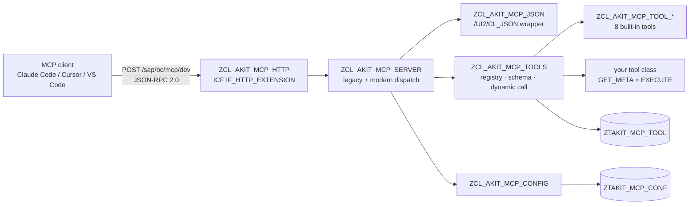

# akit-mcp

> **Turn an ordinary ABAP static method into an MCP tool.** One ICF node inside SAP, stateless JSON-RPC 2.0, no SSE, no session — and adding a tool never means writing JSON again.

<p align="center">
  <a href="LICENSE"></a>
  
  
</p>

```bash
git clone https://github.com/chunrichi/akit-mcp.git && cd akit-mcp && \
  abap init --profile <profile> --package '$TMP' && \
  node scripts/install.mjs
```

📖 **简体中文**: [README.zh-CN.md](README.zh-CN.md)

---

`akit-mcp` is a minimal [Model Context Protocol](https://modelcontextprotocol.io) server implemented in ABAP and deployed with [abap-cli](https://github.com/chunrichi/abap-cli). It lives inside your SAP system as a single ICF node (`/sap/bc/mcp`), speaks JSON-RPC 2.0 over plain HTTP POST, and exposes read-only tools that any MCP client (Claude Code, Cursor, VS Code Copilot, your own agent) can call with nothing but Basic auth.

It is built for **classic ABAP teams on ECC / S/4HANA**, not for ABAP Cloud: no RAP, no ADT plugin, no abapGit, no SDK to learn.

## Why akit-mcp

| What you want | The usual way | With akit-mcp |
|---|---|---|
| Let an AI client read SAP data | Write RFC/BAPIs or a web service, then build glue code | One ICF node, one POST endpoint |
| Expose an existing ABAP method | Hand-write JSON Schema and parameter plumbing | Class + DDIC structure + one registry row |
| Give different teams different tools | Run separate services/gateways | Multiple endpoints under `/sap/bc/mcp` |
| Authenticate callers | Build an SSO/OAuth proxy | Reuse ICF login (Basic/SSO) and SAP authorizations |
| Ship changes | Transport ABAP + JSON configs | AFF sources in Git, `install.mjs` is idempotent |

## Features

- **One ICF node, POST-only.** `/sap/bc/mcp` is created by the installer; no gateway, no server process, no SSE stream.
- **Add a tool without writing JSON.** A tool is a class with `GET_META` + `EXECUTE` and a DDIC argument structure; the framework derives the JSON Schema from the structure (field names, types, `@EndUserText.label` texts, `required` list) and binds `arguments` back to the structure.
- **Multi-endpoint.** `/sap/bc/mcp/<endpoint>`; each endpoint has its own tool set (`ZTAKIT_MCP_TOOL`) and configuration (`ZTAKIT_MCP_CONF`). The bare node returns an endpoint catalogue.
- **Legacy + modern clients.** Supports MCP `2025-03-26` / `2025-06-18` / `2025-11-25` (legacy) and `2026-07-28` (modern: `server/discover`, per-request `_meta`, header mirroring, `resultType` envelope).
- **Read-only by default.** `READ_ONLY = X` hides and rejects any tool flagged `write`; all eight built-in tools are read-only.
- **SAP-native security.** Authentication is ICF login; each tool runs its own standard `AUTHORITY-CHECK` (no custom authorization objects to maintain).
- **Tiny footprint.** 2 transparent tables, ~30 ABAP objects (framework, 8 tool classes, 7 argument structures); no background jobs, no queues, no state.

## Architecture



One request flows through five steps:

1. ICF receives `POST /sap/bc/mcp/<endpoint>` and forces the session to stateless.
2. `ZCL_AKIT_MCP_HTTP` checks the HTTP method, `Origin`/CORS, `Content-Type` and endpoint path.
3. `ZCL_AKIT_MCP_SERVER` parses JSON-RPC, detects the protocol era, validates headers/`_meta`, dispatches the method.
4. `ZCL_AKIT_MCP_TOOLS` loads the endpoint's registry rows, builds schemas, deserializes `arguments` into the tool's DDIC structure and calls `EXECUTE` dynamically.
5. The response is a JSON-RPC result (`200`), an empty `202` for notifications, or a transport error (`4xx`).

## Requirements

| Component | Minimum | Notes |
|---|---|---|
| SAP_BASIS | **7.50** | ECC EHP8 or S/4HANA. S/4HANA verified; ECC not yet validated on a live system. |
| SAP_UI | **7.40** | `/UI2/CL_JSON` is used for JSON parse/serialize. |
| ICF | enabled | Service node `/sap/bc/mcp`, handler `ZCL_AKIT_MCP_HTTP`. |
| abap-cli | 2.x | Deploys AFF sources (`abap push` / `abap activate` / `abap run`). |
| Node.js | **>= 20** | Installer and helper scripts. |

## Install

Use a disposable system or `$TMP` first. Every step is idempotent.

```bash
# 1. Clone the sources (AFF layout, no abapGit)
git clone https://github.com/chunrichi/akit-mcp.git
cd akit-mcp

# 2. Bind the ABAP workspace to a system profile (once, from the repository root)
abap init --profile <profile> --package '$TMP'

# 3. Create, push and activate every object, create the ICF node /sap/bc/mcp,
#    then seed the built-in tools into the default `dev` endpoint
node scripts/install.mjs
#    (the installer runs `abap run zcl_akit_mcp_setup` at the end; rerun it any time)

# 4. Verify the protocol without HTTP: legacy/modern dispatch, error codes, JSON escaping
abap run zcl_akit_mcp_selftest

# 5. Smoke test through the real ICF endpoint with the bundled client
node scripts/akit-mcp.mjs --url https://<host>:<port>/sap/bc/mcp/dev --user <u> --password <p> tools
node scripts/akit-mcp.mjs --url https://<host>:<port>/sap/bc/mcp/dev --user <u> --password <p> call sap_info
```

`zcl_akit_mcp_setup` prints a JSON report (`status`, `endpoint`, `url`, `tools`, `added`, `invalid`). `zcl_akit_mcp_selftest` exercises the protocol dispatcher directly (no ICF), which is the fastest way to confirm a fresh install. Re-running the setup is safe: existing registry rows are never overwritten, so local enable/disable and sort changes survive upgrades.

**Production:** deploy the objects with your own package and transport request instead of `$TMP`, then run the setup report in the target client:

```bash
node scripts/install.mjs --package ZAKIT_MCP --tr <transport-request>
```

Installer options: `--package <pkg>` (default `$TMP`), `--tr <transport>` (required for transportable packages), `--dry-run` (print the plan, write nothing), `--yes`.

Upgrade path: `git pull` → `node scripts/install.mjs` → `abap run zcl_akit_mcp_setup`. New built-in tools are seeded automatically; existing rows are kept.

## Connect a client

All clients use **remote HTTP transport with Basic auth**. Build the header once:

```bash
printf '%s:%s' '<user>' '<password>' | base64
```

**Claude Code**

```bash
claude mcp add --transport http akit-dev \
  https://<host>:<port>/sap/bc/mcp/dev \
  --header "Authorization: Basic <base64(user:password)>"
```

**Cursor** (`.cursor/mcp.json`)

```json
{
  "mcpServers": {
    "akit-dev": {
      "url": "https://<host>:<port>/sap/bc/mcp/dev",
      "headers": { "Authorization": "Basic <base64(user:password)>" }
    }
  }
}
```

**VS Code** (`.vscode/mcp.json`)

```json
{
  "servers": {
    "akit-dev": {
      "type": "http",
      "url": "https://<host>:<port>/sap/bc/mcp/dev",
      "headers": { "Authorization": "Basic <base64(user:password)>" }
    }
  }
}
```

Use the full URL including the endpoint (`.../sap/bc/mcp/dev`), not the bare ICF node. A browser/CORS client needs `ORIGINS` configured (see [docs/security.md](docs/security.md)).

## Quick start

The absolute minimum is three JSON-RPC requests (any HTTP client works):

```bash
U='https://<host>:<port>/sap/bc/mcp/dev'; A='-u <user>:<password>'

# initialize (legacy handshake)
curl -s $A -X POST "$U" -H 'Content-Type: application/json' \
  -d '{"jsonrpc":"2.0","id":1,"method":"initialize","params":{"protocolVersion":"2025-11-25","capabilities":{},"clientInfo":{"name":"curl","version":"0"}}}'

# list the tools of this endpoint
curl -s $A -X POST "$U" -H 'Content-Type: application/json' \
  -H 'MCP-Protocol-Version: 2025-11-25' \
  -d '{"jsonrpc":"2.0","id":2,"method":"tools/list"}'

# call one
curl -s $A -X POST "$U" -H 'Content-Type: application/json' \
  -H 'MCP-Protocol-Version: 2025-11-25' \
  -d '{"jsonrpc":"2.0","id":3,"method":"tools/call","params":{"name":"sap_info","arguments":{}}}'
```

The bare node `GET /sap/bc/mcp` returns the endpoint catalogue; `GET` on an endpoint returns `405` (there is no SSE stream). Full protocol details, including modern `2026-07-28` requests, are in [docs/protocol.md](docs/protocol.md).

## Write your first tool

Three steps: one DDIC structure, one class, one registry row. No JSON.

```abap
" 1) SE11: create structure ZSAKIT_MCP_TOOL_STOCK_ARGS
"    MATERIAL CHAR 18, PLANT CHAR 4 (labels become the parameter descriptions)

CLASS zcl_akit_mcp_tool_stock DEFINITION PUBLIC FINAL CREATE PUBLIC.
  PUBLIC SECTION.
    CLASS-METHODS get_meta
      RETURNING VALUE(rs_meta) TYPE zcl_akit_mcp_types=>ty_tool_meta.
    CLASS-METHODS execute
      IMPORTING is_args         TYPE zsakit_mcp_tool_stock_args
      RETURNING VALUE(rv_result) TYPE string.
ENDCLASS.

CLASS zcl_akit_mcp_tool_stock IMPLEMENTATION.
  METHOD get_meta.
    rs_meta = VALUE #(
      name        = 'stock_check'
      title       = 'Stock check'
      description = 'Read non-restricted stock by material and plant (read-only).'
      args_struct = 'ZSAKIT_MCP_TOOL_STOCK_ARGS'
      required    = VALUE #( ( `MATERIAL` ) ( `PLANT` ) ) ).
  ENDMETHOD.

  METHOD execute.
    SELECT matnr, werks, labst, meins FROM mard
      INTO TABLE @DATA(lt_rows)
      WHERE matnr = @is_args-material
        AND werks = @is_args-plant.
    rv_result = zcl_akit_mcp_json=>to_json( lt_rows ).
  ENDMETHOD.
ENDCLASS.
```

1. **Create the DDIC structure.** Field names become MCP parameter names (camelCase); field labels/texts become schema descriptions. Put the check limits inside `EXECUTE`.
2. **Create the class** with `GET_META` (metadata) and `EXECUTE` (implementation). Both must be `PUBLIC` `CLASS-METHODS`; the class name must be ≤ 30 characters. Return a JSON string, raise `ZCX_AKIT_MCP_TOOL_ERROR` for business errors.
3. **Register one row** in `ZTAKIT_MCP_TOOL`: `SERVER = dev`, `TOOL_CLASS = ZCL_AKIT_MCP_TOOL_STOCK`, `TOOL_ENABLED = X`, `TOOL_SORT = 100`. Reconnect the client (no `listChanged` notification) and call `stock_check`.

The full guide, including `raw_args` mode for nested input and debugging tips, is in [docs/writing-a-tool.md](docs/writing-a-tool.md).

## Built-in tools

All eight are read-only and seeded into the default `dev` endpoint by `zcl_akit_mcp_setup`.

| Tool | What it does | Key arguments |
|---|---|---|
| `sap_info` | System, client, user, release, database, host, language, date/time | — |
| `object_search` | Search TADIR for repository objects | `pattern`, `objectType`, `packageName`, `maxRows` |
| `source_read` | Read source of CLAS / INTF / PROG | `objectName`, `objectType`, `maxLines` |
| `syntax_check` | Syntax-check ABAP source without saving it | `source`, `programName` |
| `ddic_get` | DDIC metadata: TABL / VIEW / STRU fields, DTEL | `objectName`, `objectType` |
| `table_read` | Read transparent tables / views with filters and limits | `tableName`, `fields`, `whereClause`, `orderBy`, `maxRows` |
| `tcode_info` | Transaction code → program, screen, text | `tcode` |
| `message_text` | T100 message text with variable substitution | `msgClass`, `msgNo`, `variables` |

Parameter tables, JSON result shapes and authorization checks are documented in [docs/tools.md](docs/tools.md).

## Configuration

Configuration is a key/value table, `ZTAKIT_MCP_CONF`, scoped per endpoint; `SERVER = '*'` is the global default and an endpoint row overrides it.

| Key | Default | Meaning |
|---|---|---|
| `ENABLED` | `X` | Master switch. Not `X` → requests get `503`. |
| `READ_ONLY` | `X` | `X` hides and rejects tools flagged `write`. |
| `MAX_ROWS` | `200` | Row limit for query tools; hard cap `5000`. |
| `ORIGINS` | empty | Comma-separated CORS allow-list. Empty = reject browser `Origin`. |
| `INSTRUCTIONS` | empty | Overrides the `instructions` text in `initialize` / `server/discover`. |
| `TITLE` | `AKIT MCP - <endpoint>` | `serverInfo.title`. |

Each endpoint also gets its own tool set from `ZTAKIT_MCP_TOOL` (`SERVER` is the endpoint name). Registering a tool for another endpoint is just another registry row with a different `SERVER`.

## Security

- **Authentication is ICF login** (Basic or SSO). No anonymous access, no service account, no OAuth server.
- **Authorization stays in SAP.** Each tool runs its own standard `AUTHORITY-CHECK` (`S_DEVELOP`, `S_TABU_NAM`, …); the framework adds no custom authorization objects.
- **Read-only by default.** `READ_ONLY = X`; v1 ships no write tools.
- **Endpoint isolation** is for exposure management, not a security boundary — the real boundary is the SAP user's authorizations.
- **Production:** TLS only, non-anonymous ICF login, least-privilege role, empty `ORIGINS` unless a browser needs access, network restricted to internal/VPN/API gateway. Full checklist in [docs/security.md](docs/security.md).

## Limitations

- **No SSE, no server notifications, no session.** `GET` on an endpoint returns `405`; no `Mcp-Session-Id` is ever issued. Clients do not receive `tools/list_changed`, so reconnect after adding a tool.
- **No `resources`, `prompts`, `tasks`, `sampling`, `elicitation` or `logging`.** Only the `tools` capability is advertised.
- **No write tools in v1.** The framework supports a `write` flag and the `READ_ONLY` switch; the built-in tools are all read-only.
- **No OAuth.** OAuth-only clients (for example ChatGPT custom connectors) need a gateway in front.
- **`required` is schema-only.** The server does not enforce required arguments at the framework level; each tool implementation validates its own input.
- **`/sap/bc/mcp` is not the MCP protocol.** The bare node returns an endpoint catalogue; point clients at `/sap/bc/mcp/<endpoint>`.
- **ECC is unverified.** S/4HANA is verified; ECC EHP8 is supported by design (classic 7.50 APIs) but has not been tested on a live ECC system. See [docs/compatibility.md](docs/compatibility.md).
- **`/UI2/CL_JSON` is required** (SAP_UI 7.40+); systems without SAP_UI cannot compile the framework.

## Repository layout

```text
akit-mcp/
├── .abap.json.example          # abap-cli workspace template (repository root)
├── abap/
│   └── src/                    # AFF sources: classes, tables, structures, ICF node, context program
├── scripts/
│   ├── install.mjs             # idempotent installer (push/activate objects + create the ICF node)
│   ├── akit-mcp.mjs            # local MCP client (debugging)
│   ├── check-aff.mjs           # AFF source check (no SAP)
│   └── check-docs.mjs          # documentation link check (no SAP)
├── docs/                       # protocol, tools, writing-a-tool, security, compatibility, troubleshooting
├── .github/workflows/verify.yml
├── README.md / README.zh-CN.md
├── CHANGELOG.md / CONTRIBUTING.md / AGENTS.md / LICENSE
└── package.json
```

## Documentation

| Document | Contents |
|---|---|
| [docs/design.md](docs/design.md) | Design contract: layering, tool model, tables, protocol decisions |
| [docs/protocol.md](docs/protocol.md) | MCP methods, versions, header validation, error codes, curl acceptance sequence |
| [docs/tools.md](docs/tools.md) | Reference for the eight built-in tools |
| [docs/writing-a-tool.md](docs/writing-a-tool.md) | Write and register your own tool |
| [docs/security.md](docs/security.md) | Authentication, authorization, deployment checklist |
| [docs/compatibility.md](docs/compatibility.md) | SAP versions, `/UI2/CL_JSON`, verified/unverified items |
| [docs/troubleshooting.md](docs/troubleshooting.md) | Symptom → cause → fix |
| [docs/verification.md](docs/verification.md) | Real-system verification record (S/4HANA 757): deployment, 26 protocol cases, tool smoke tests, open items |
| [CHANGELOG.md](CHANGELOG.md) | Release history |

## Contributing

Read [CONTRIBUTING.md](CONTRIBUTING.md) and [AGENTS.md](AGENTS.md) first. Commits follow Conventional Commits (English imperative, ≤ 72 characters); documentation is Chinese under `docs/` and bilingual for the README; `npm run verify` must pass before opening a pull request. SAP changes need a real-system verification note; never commit credentials, host names or transport numbers.

## License

MIT — see [LICENSE](LICENSE).
