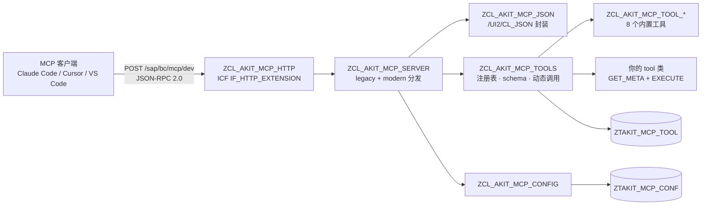

# akit-mcp

> **把 SAP 里的普通 ABAP 静态方法变成 MCP tool。** 一个 ICF 节点、无状态 JSON-RPC 2.0、无 SSE、无 session —— 加工具时永远不用再写 JSON。

<p align="center">
  <a href="LICENSE"></a>
  
  
</p>

```bash
git clone https://github.com/chunrichi/akit-mcp.git && cd akit-mcp && \
  abap init --profile <profile> --package '$TMP' && \
  node scripts/install.mjs
```

📖 **English**: [README.md](README.md)

---

`akit-mcp` 是一个用 ABAP 实现、用 [abap-cli](https://github.com/chunrichi/abap-cli) 部署的极简 [Model Context Protocol](https://modelcontextprotocol.io) Server。它以单个 ICF 节点（`/sap/bc/mcp`）的形式装在 SAP 内部，用纯 HTTP POST 承载 JSON-RPC 2.0，把只读工具暴露给任意 MCP 客户端（Claude Code、Cursor、VS Code Copilot、自研 agent）；客户端只需要 Basic 认证即可调用。

它面向 **ECC / S/4HANA 上的常规 ABAP 团队**，不是 ABAP Cloud：不用 RAP、不用 ADT 插件、不用 abapGit、不用学 SDK。

## 为什么是 akit-mcp

| 想做的事 | 原来的做法 | 用 akit-mcp |
|---|---|---|
| 让 AI 客户端读 SAP 数据 | 写 RFC/BAPI 或 web service，再写胶水代码 | 一个 ICF 节点、一个 POST endpoint |
| 暴露已有的 ABAP 方法 | 手写 JSON Schema 和参数转换 | 一个类 + 一个 DDIC 结构 + 注册表一行 |
| 给不同团队不同工具 | 起多个服务/网关 | `/sap/bc/mcp` 下多个 endpoint |
| 认证调用者 | 自建 SSO/OAuth 代理 | 复用 ICF 登录（Basic/SSO）与 SAP 权限 |
| 发布变更 | 传 ABAP + 传 JSON 配置 | AFF 源码进 Git，`install.mjs` 幂等 |

## 特性

- **一个 ICF 节点，只收 POST。** `/sap/bc/mcp` 由安装器创建；没有网关、没有常驻进程、没有 SSE 流。
- **加工具不写 JSON。** 一个 tool = 一个带 `GET_META` + `EXECUTE` 的类 + 一个 DDIC 入参结构；框架从结构推导 JSON Schema（字段名、类型、`@EndUserText.label` 文本、`required` 清单），并把 `arguments` 绑定回结构。
- **多 endpoint。** `/sap/bc/mcp/<endpoint>`；每个 endpoint 有自己的工具集（`ZTAKIT_MCP_TOOL`）与配置（`ZTAKIT_MCP_CONF`）。根路径返回 endpoint 目录。
- **legacy + modern 双 era。** 支持 MCP `2025-03-26` / `2025-06-18` / `2025-11-25`（legacy）与 `2026-07-28`（modern：`server/discover`、每请求 `_meta`、头镜像、`resultType` 信封）。
- **默认只读。** `READ_ONLY = X` 时 `write` 标记的工具被隐藏并拒绝；8 个内置工具全部只读。
- **SAP 原生安全。** 认证走 ICF 登录；每个工具自己跑标准 `AUTHORITY-CHECK`（不需要维护自定义授权对象）。
- **极简占用。** 2 张透明表、约 30 个 ABAP 对象（框架 + 8 个 tool 类 + 7 个入参结构）；无后台作业、无队列、无状态。

## 架构



一个请求经过五步：

1. ICF 收到 `POST /sap/bc/mcp/<endpoint>`，强制把会话设为无状态。
2. `ZCL_AKIT_MCP_HTTP` 校验 HTTP 方法、`Origin`/CORS、`Content-Type` 与 endpoint 路径。
3. `ZCL_AKIT_MCP_SERVER` 解析 JSON-RPC、判定协议 era、校验请求头/`_meta`、分发方法。
4. `ZCL_AKIT_MCP_TOOLS` 读取 endpoint 的注册表行、生成 schema、把 `arguments` 反序列化成工具的 DDIC 结构并动态调用 `EXECUTE`。
5. 响应是 JSON-RPC result（`200`）、通知的空 `202`，或传输层错误（`4xx`）。

## 环境要求

| 组件 | 最低要求 | 说明 |
|---|---|---|
| SAP_BASIS | **7.50** | ECC EHP8 或 S/4HANA。S/4HANA 已验证；ECC 未在真机验证。 |
| SAP_UI | **7.40** | 使用 `/UI2/CL_JSON` 做 JSON 解析/序列化。 |
| ICF | 已启用 | 服务节点 `/sap/bc/mcp`，处理器 `ZCL_AKIT_MCP_HTTP`。 |
| abap-cli | 2.x | 推送 AFF 源码（`abap push` / `abap activate` / `abap run`）。 |
| Node.js | **>= 20** | 安装器与辅助脚本。 |

## 安装

先在可丢弃的系统或 `$TMP` 里试。每一步都是幂等的。

```bash
# 1. 拉源码（AFF 布局，不依赖 abapGit）
git clone https://github.com/chunrichi/akit-mcp.git
cd akit-mcp

# 2. 绑定 ABAP 工作区到系统 profile（一次，在仓库根目录执行）
abap init --profile <profile> --package '$TMP'

# 3. 创建/推送/激活全部对象、创建 ICF 节点 /sap/bc/mcp，
#    并把内置工具播种到默认 endpoint dev
node scripts/install.mjs
#    （安装器最后会自动跑一次 abap run zcl_akit_mcp_setup；也可随时手动重跑）

# 4. 协议自检（不经过 HTTP）：legacy/modern 分发、错误码、JSON 转义
abap run zcl_akit_mcp_selftest

# 5. 用自带客户端走真实 ICF 端点做冒烟测试
node scripts/akit-mcp.mjs --url https://<host>:<port>/sap/bc/mcp/dev --user <u> --password <p> tools
node scripts/akit-mcp.mjs --url https://<host>:<port>/sap/bc/mcp/dev --user <u> --password <p> call sap_info
```

`zcl_akit_mcp_setup` 会打印 JSON 报告（`status`、`endpoint`、`url`、`tools`、`added`、`invalid`）；`zcl_akit_mcp_selftest` 直接调用协议层（不经过 ICF）做自检，是新装环境最快的验证手段。重复执行 setup 是安全的：已存在的注册表行不会被覆盖，本地启停与排序变更可以跨升级保留。

**生产系统：** 用自有包 + 传输请求部署对象，不要用 `$TMP`；然后在目标客户端跑一次 setup 自检：

```bash
node scripts/install.mjs --package ZAKIT_MCP --tr <transport-request>
```

安装器参数：`--package <pkg>`（默认 `$TMP`）、`--tr <transport>`（可传输包必填）、`--dry-run`（只打印计划，不写 SAP）、`--yes`。

升级路径：`git pull` → `node scripts/install.mjs` → `abap run zcl_akit_mcp_setup`。新增的内置工具会自动播种，已有行保持不变。

## 连接客户端

所有客户端都用 **remote HTTP transport + Basic 认证**。先构造认证头：

```bash
printf '%s:%s' '<user>' '<password>' | base64
```

**Claude Code**

```bash
claude mcp add --transport http akit-dev \
  https://<host>:<port>/sap/bc/mcp/dev \
  --header "Authorization: Basic <base64(user:password)>"
```

**Cursor**（`.cursor/mcp.json`）

```json
{
  "mcpServers": {
    "akit-dev": {
      "url": "https://<host>:<port>/sap/bc/mcp/dev",
      "headers": { "Authorization": "Basic <base64(user:password)>" }
    }
  }
}
```

**VS Code**（`.vscode/mcp.json`）

```json
{
  "servers": {
    "akit-dev": {
      "type": "http",
      "url": "https://<host>:<port>/sap/bc/mcp/dev",
      "headers": { "Authorization": "Basic <base64(user:password)>" }
    }
  }
}
```

URL 要带 endpoint 段（`.../sap/bc/mcp/dev`），不要只填 ICF 根节点。浏览器/CORS 客户端需要配置 `ORIGINS`（见 [docs/security.md](docs/security.md)）。

## 快速开始

最小可用路径是三个 JSON-RPC 请求（任意 HTTP 客户端即可）：

```bash
U='https://<host>:<port>/sap/bc/mcp/dev'; A='-u <user>:<password>'

# initialize（legacy 握手）
curl -s $A -X POST "$U" -H 'Content-Type: application/json' \
  -d '{"jsonrpc":"2.0","id":1,"method":"initialize","params":{"protocolVersion":"2025-11-25","capabilities":{},"clientInfo":{"name":"curl","version":"0"}}}'

# 列出该 endpoint 的 tool
curl -s $A -X POST "$U" -H 'Content-Type: application/json' \
  -H 'MCP-Protocol-Version: 2025-11-25' \
  -d '{"jsonrpc":"2.0","id":2,"method":"tools/list"}'

# 调用其中一个
curl -s $A -X POST "$U" -H 'Content-Type: application/json' \
  -H 'MCP-Protocol-Version: 2025-11-25' \
  -d '{"jsonrpc":"2.0","id":3,"method":"tools/call","params":{"name":"sap_info","arguments":{}}}'
```

根节点 `GET /sap/bc/mcp` 返回 endpoint 目录；对 endpoint 发 `GET` 返回 `405`（本服务没有 SSE 流）。完整协议细节（含 modern `2026-07-28` 请求）见 [docs/protocol.md](docs/protocol.md)。

## 写第一个 tool

三步：一个 DDIC 结构、一个类、注册表一行。不写 JSON。

```abap
" 1) SE11：建结构 ZSAKIT_MCP_TOOL_STOCK_ARGS
"    MATERIAL CHAR 18、PLANT CHAR 4（字段文本即参数描述）

CLASS zcl_akit_mcp_tool_stock DEFINITION PUBLIC FINAL CREATE PUBLIC.
  PUBLIC SECTION.
    CLASS-METHODS get_meta
      RETURNING VALUE(rs_meta) TYPE zcl_akit_mcp_types=>ty_tool_meta.
    CLASS-METHODS execute
      IMPORTING is_args         TYPE zsakit_mcp_tool_stock_args
      RETURNING VALUE(rv_result) TYPE string.
ENDCLASS.

CLASS zcl_akit_mcp_tool_stock IMPLEMENTATION.
  METHOD get_meta.
    rs_meta = VALUE #(
      name        = 'stock_check'
      title       = '库存查询'
      description = '按物料与工厂查询非限制库存（只读）。'
      args_struct = 'ZSAKIT_MCP_TOOL_STOCK_ARGS'
      required    = VALUE #( ( `MATERIAL` ) ( `PLANT` ) ) ).
  ENDMETHOD.

  METHOD execute.
    SELECT matnr, werks, labst, meins FROM mard
      INTO TABLE @DATA(lt_rows)
      WHERE matnr = @is_args-material
        AND werks = @is_args-plant.
    rv_result = zcl_akit_mcp_json=>to_json( lt_rows ).
  ENDMETHOD.
ENDCLASS.
```

1. **建 DDIC 结构。** 字段名就是 MCP 参数名（camelCase）；字段文本/数据元素文本就是 schema 描述。校验与限额写在 `EXECUTE` 里。
2. **建类**，实现 `GET_META`（元数据）与 `EXECUTE`（实现）。两个方法都必须是 `PUBLIC` `CLASS-METHODS`；类名不能超过 30 字符。返回 JSON 字符串，业务错误抛 `ZCX_AKIT_MCP_TOOL_ERROR`。
3. **注册一行**到 `ZTAKIT_MCP_TOOL`：`SERVER = dev`、`TOOL_CLASS = ZCL_AKIT_MCP_TOOL_STOCK`、`TOOL_ENABLED = X`、`TOOL_SORT = 100`。重连客户端（没有 `listChanged` 通知）后调用 `stock_check`。

完整指南（含 `raw_args` 嵌套入参模式与调试方法）见 [docs/writing-a-tool.md](docs/writing-a-tool.md)。

## 内置工具

8 个工具全部只读，由 `zcl_akit_mcp_setup` 播种到默认 endpoint `dev`。

| Tool | 用途 | 主要参数 |
|---|---|---|
| `sap_info` | 系统、客户端、用户、版本、数据库、主机、语言、日期时间 | — |
| `object_search` | 按名称模式搜索 TADIR 仓库对象 | `pattern`、`objectType`、`packageName`、`maxRows` |
| `source_read` | 读取 CLAS / INTF / PROG 源码 | `objectName`、`objectType`、`maxLines` |
| `syntax_check` | 对 ABAP 源码做语法检查（不保存） | `source`、`programName` |
| `ddic_get` | DDIC 元数据：TABL / VIEW / STRU 字段清单、DTEL | `objectName`、`objectType` |
| `table_read` | 带条件/排序/行数上限的透明表/视图只读查询 | `tableName`、`fields`、`whereClause`、`orderBy`、`maxRows` |
| `tcode_info` | 事务码 → 程序、屏幕、文本 | `tcode` |
| `message_text` | T100 消息文本与变量替换 | `msgClass`、`msgNo`、`variables` |

参数表、返回 JSON 形状与授权检查见 [docs/tools.md](docs/tools.md)。

## 配置

配置存在键值表 `ZTAKIT_MCP_CONF`，按 endpoint 生效；`SERVER = '*'` 是全局默认值，endpoint 行覆盖它。

| 键 | 默认值 | 含义 |
|---|---|---|
| `ENABLED` | `X` | 总开关。非 `X` → 请求返回 `503`。 |
| `READ_ONLY` | `X` | `X` 时隐藏并拒绝 `write` 标记的工具。 |
| `MAX_ROWS` | `200` | 查询类工具的行数上限；硬顶 `5000`。 |
| `ORIGINS` | 空 | 逗号分隔的 CORS 白名单。空 = 拒绝浏览器 `Origin`。 |
| `INSTRUCTIONS` | 空 | 覆盖 `initialize` / `server/discover` 里的 `instructions` 文本。 |
| `TITLE` | `AKIT MCP - <endpoint>` | `serverInfo.title`。 |

每个 endpoint 的工具集来自 `ZTAKIT_MCP_TOOL`（`SERVER` 即 endpoint 名）。要注册到别的 endpoint，只是同一张表里换一个 `SERVER` 值而已。

## 安全

- **认证就是 ICF 登录**（Basic 或 SSO）。没有匿名访问、没有服务账号、没有 OAuth 服务器。
- **鉴权留在 SAP。** 每个工具自己跑标准 `AUTHORITY-CHECK`（`S_DEVELOP`、`S_TABU_NAM` 等）；框架不引入自定义授权对象。
- **默认只读。** `READ_ONLY = X`；v1 不发布写工具。
- **endpoint 隔离是暴露面管理，不是安全边界**——真正的边界是该 SAP 用户有没有对应权限。
- **生产环境：** 只走 TLS、ICF 登录过程非匿名、最小权限角色、没有浏览器客户端时 `ORIGINS` 留空、网络限制在内网/VPN/API Gateway。完整清单见 [docs/security.md](docs/security.md)。

## 限制

- **无 SSE、无服务端通知、无 session。** 对 endpoint 发 `GET` 返回 `405`；从不发 `Mcp-Session-Id`。客户端收不到 `tools/list_changed`，加工具后需要重连。
- **不支持 `resources`、`prompts`、`tasks`、`sampling`、`elicitation`、`logging`。** 能力只声明 `tools`。
- **v1 没有写工具。** 框架支持 `write` 标记与 `READ_ONLY` 开关；内置工具全部只读。
- **没有 OAuth。** 只支持 OAuth 的客户端（例如 ChatGPT 自定义 connector）前面需要网关。
- **`required` 只在 schema 层。** 服务端不做框架级必填校验；每个工具实现自己校验入参。
- **`/sap/bc/mcp` 不是 MCP 协议。** 根节点返回 endpoint 目录，客户端要指向 `/sap/bc/mcp/<endpoint>`。
- **ECC 未验证。** S/4HANA 已验证；ECC EHP8 按设计支持（经典 7.50 API），但没在真实 ECC 系统上测过。见 [docs/compatibility.md](docs/compatibility.md)。
- **依赖 `/UI2/CL_JSON`**（SAP_UI 7.40+）；没装 SAP_UI 的系统无法编译框架。

## 目录结构

```text
akit-mcp/
├── .abap.json.example          # abap-cli 工作区模板（仓库根目录）
├── abap/
│   └── src/                    # AFF 源码：类、表、结构、ICF 节点、上下文程序
├── scripts/
│   ├── install.mjs             # 幂等安装器（推送/激活对象 + 创建 ICF 节点）
│   ├── akit-mcp.mjs            # 本地 MCP 客户端（调试用）
│   ├── check-aff.mjs           # AFF 源码校验（不连 SAP）
│   └── check-docs.mjs          # 文档链接校验（不连 SAP）
├── docs/                       # 协议、工具、写工具、安全、兼容性、排障
├── .github/workflows/verify.yml
├── README.md / README.zh-CN.md
├── CHANGELOG.md / CONTRIBUTING.md / AGENTS.md / LICENSE
└── package.json
```

## 文档

| 文档 | 内容 |
|---|---|
| [docs/design.md](docs/design.md) | 设计契约：分层、tool 模型、表设计、协议决策 |
| [docs/protocol.md](docs/protocol.md) | MCP 方法、版本、请求头校验、错误码、curl 验收序列 |
| [docs/tools.md](docs/tools.md) | 8 个内置工具参考 |
| [docs/writing-a-tool.md](docs/writing-a-tool.md) | 写并注册自己的 tool |
| [docs/security.md](docs/security.md) | 认证、鉴权、部署清单 |
| [docs/compatibility.md](docs/compatibility.md) | SAP 版本、`/UI2/CL_JSON`、已验证/未验证项 |
| [docs/troubleshooting.md](docs/troubleshooting.md) | 症状 → 原因 → 处理 |
| [CHANGELOG.md](CHANGELOG.md) | 版本历史 |

## 贡献

先读 [CONTRIBUTING.md](CONTRIBUTING.md) 与 [AGENTS.md](AGENTS.md)。提交信息遵循 Conventional Commits（英文祈使句、≤ 72 字符）；`docs/` 是中文、README 中英对照；开 PR 前必须让 `npm run verify` 通过。涉及 SAP 的改动需要在 PR 里写明真机验证结果；永远不要提交凭证、主机名或传输号。

## 许可证

MIT —— 见 [LICENSE](LICENSE)。
