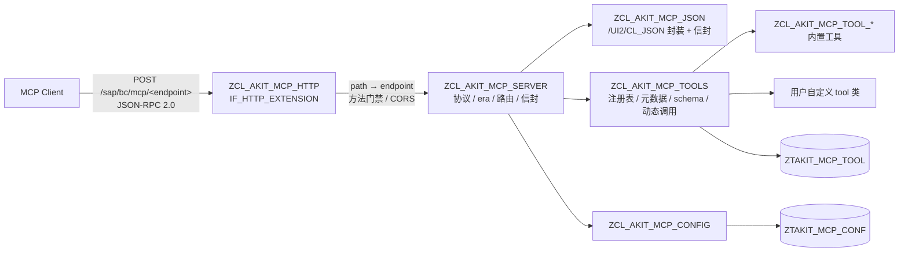

# AKIT MCP 设计

> 用 ABAP 实现的 MCP Server：装在 SAP 内部、无状态、多 endpoint、ECC 常规开发友好。
> 本文是实现契约，不是宣传材料；改设计先改本文。

## 1. 定位

### 1.1 一句话

把 SAP 里的**普通 ABAP 静态方法**注册成 MCP tool，让任意 MCP 客户端（Claude Code / Cursor / VS Code / 自研 agent）通过标准 HTTP + JSON-RPC 直接调用 SAP 内部的业务逻辑与元数据；一个 ICF 节点下可以发布**多套 tool 集（endpoint）**。

### 1.2 要解决的问题

- 现有 ABAP MCP 实现（`abap-ai/mcp`、`abap-ai/mcp2`）是通用 SDK：会话 / SSE / prompts / resources / tasks / schema builder / 多张配置表，安装与维护成本高，面向 ABAP Cloud / 新版本能力强，但对**常规 ECC 项目**过重。
- 常规 ABAP 团队需要的：一个 ICF 节点 + 把已有或新写的 ABAP 方法暴露成 tool + 加 tool 时只写 ABAP 不写 JSON + 多个业务域各自一套 tool。
- 项目本身要能被 `abap-cli` 维护：AFF 源码进 Git、`push` / `activate` 部署、`abap run` 自检，不依赖 abapGit。

### 1.3 非目标（v1 明确不做）

- SSE / 服务端主动推送、会话（`Mcp-Session-Id`）、`resources` / `prompts` / `sampling` / `elicitation` / `tasks` / `completions` / `logging`。
- 写 SAP 开发对象（建类、改源码、激活、传输）——由 `abap-cli` 承担，本服务专注「运行期能力暴露」。
- ABAP Cloud / RAP / Steampunk 适配。目标 SAP_BASIS 7.50（ECC EHP8）与 S/4HANA，依赖 SAP_UI 7.40+ 的 `/UI2/CL_JSON`。
- OAuth 授权服务器。认证复用 ICF 登录（Basic / SSO），鉴权复用标准 authorization object。

## 2. 总体架构



### 2.1 分层职责

| 层 | 类 | 职责 | 约束 |
|---|---|---|---|
| 传输 | `ZCL_AKIT_MCP_HTTP` | ICF 入口：无状态、路径→endpoint、方法门禁、CORS、读写 HTTP | 不解析 MCP 语义 |
| 协议 | `ZCL_AKIT_MCP_SERVER` | JSON-RPC 解析、era 判定、方法分发、错误码、结果信封、endpoint 校验 | 不直连数据库、不碰 ICF 对象 |
| JSON | `ZCL_AKIT_MCP_JSON` | `/UI2/CL_JSON` 封装、`_meta` 提取、信封/错误/合并、命名转换 | 不实现 JSON parser |
| 工具 | `ZCL_AKIT_MCP_TOOLS` | 注册表读取、`GET_META` 调用、DDIC → JSON Schema、参数绑定、动态调用 | 唯一的动态调用点 |
| 配置 | `ZCL_AKIT_MCP_CONFIG` | 键值配置（按 endpoint，`*` 全局缺省）+ 当前请求 endpoint 上下文 | 读多写少 |
| 安装 | `ZCL_AKIT_MCP_SETUP` | 幂等播种内置 tool 到默认 endpoint、写 endpoint TITLE、逐条自检 | `abap run` 执行 |
| 自检 | `ZCL_AKIT_MCP_SELFTEST` | 无 HTTP 的协议回归（legacy / modern / 错误码） | `abap run` 执行，输出 JSON 行 |

### 2.2 请求流（无状态）

1. ICF 收到请求 → `set_session_stateful( false )`。
2. `~path_info` → endpoint（只允许 `[a-z0-9_-]`、单段、≤30 字符；非法 → 404）。
3. 根路径（无 endpoint）：GET/POST 返回 endpoint 目录 JSON（非 MCP 协议）。
4. endpoint 路由：仅 `POST`；`OPTIONS` → CORS 预检 204；`GET`/`HEAD`/`DELETE`/其他 → `405 + Allow: POST, OPTIONS`。
5. `Content-Type` 非 `application/json` → 415；`Accept` 明确排除 json/event-stream → 406。
6. `Origin` 存在且不在 `ORIGINS` 白名单 → 403（浏览器客户端必须显式配置）。
7. 读 body → `ZCL_AKIT_MCP_SERVER=>handle( )` → `( status, body, content_type )`。
8. 通知（无 id）→ `202` 空 body；JSON-RPC 响应 `200`。

## 3. 协议支持

### 3.1 支持的版本

| era | 版本 | 入口判据 |
|---|---|---|
| legacy | `2025-03-26` / `2025-06-18` / `2025-11-25` | 请求头/`_meta` 未声明 modern 版本；`initialize` 属于此代 |
| modern | `2026-07-28`（已正式发布） | 每请求 `_meta.io.modelcontextprotocol/protocolVersion` 或 `MCP-Protocol-Version` 头声明 |

- legacy 用 `2025-11-25` 数据形状回复，版本协商只在 `initialize` 发生：收到不支持的版本时 **counter-offer `2025-11-25`**，不报错。
- modern 无 `initialize` / `ping`：请求必须带 `_meta`（protocolVersion、clientCapabilities 必填）与 `Mcp-Method` 头；`tools/call` 还需 `Mcp-Name` 头且必须等于 `params.name`。头/`_meta` 不一致 → `400 -32020`；版本不支持 → `400 -32022`（带 `data.supported/requested`）。
- 能力只声明 `{"tools":{}}`；不声明 `listChanged` / logging / resources / prompts。

### 3.2 方法矩阵

| 方法 | legacy | modern | 说明 |
|---|---|---|---|
| `initialize` | ✅ | —（`-32601` + 404） | 返回 protocolVersion/capabilities/serverInfo/instructions |
| `notifications/initialized` | ✅ 202 | — | 忽略 |
| `ping` | ✅ | —（`-32601` + 404） | `{}` |
| `tools/list` | ✅ | ✅ | `tools[]`：name/title/description/inputSchema/annotations（readOnlyHint、destructiveHint、openWorldHint 显式给出） |
| `tools/call` | ✅ | ✅ | 业务失败 → `isError:true` + HTTP 200；未知 tool / 缺 name → `-32602` |
| `server/discover` | —（`-32601`） | ✅ | supportedVersions/capabilities/instructions + `resultType`/`ttlMs`/`cacheScope` + `_meta.serverInfo` |
| 其他 | `-32601` | `-32601`（404） | 不支持 |

modern 每个 result 都带 `resultType:"complete"` 与 `_meta["io.modelcontextprotocol/serverInfo"]`；`ttlMs`/`cacheScope` 仅可缓存结果（discover、tools/list）携带。

### 3.3 错误映射

| 场景 | JSON-RPC | HTTP |
|---|---|---|
| body 不是合法 JSON | `-32700` | 400 |
| 非对象 / 缺 `jsonrpc` / 缺 `method` / id 为 null | `-32600` | 400 |
| 未知方法 | `-32601` | legacy 200 / modern 404 |
| 未知 tool、缺 `name`、`_meta` 缺必填 | `-32602` | 200（modern `_meta` 缺失 400） |
| tool 执行失败 | `isError:true` 的 CallToolResult | 200 |
| modern 头不匹配 | `-32020` | 400 |
| modern 协议版本不支持 | `-32022` + data | 400 |
| 服务自身异常 | `-32603` | 200 |

## 4. Tool 模型（核心设计）

### 4.1 工具作者要写什么

一个 tool = **一个类**（`GET_META` + `EXECUTE`）+ **一个 DDIC 入参结构**（可选）+ 注册表一行；同一个类可以注册到多个 endpoint。

```abap
" 1) SE11 建结构 ZSAKIT_MCP_TABLE_READ_ARGS（字段名即 MCP 参数名，camelCase 输出）
" 2) 建类：
CLASS zcl_akit_mcp_tool_xxx DEFINITION PUBLIC FINAL CREATE PUBLIC.
  PUBLIC SECTION.
    CLASS-METHODS get_meta
      RETURNING VALUE(rs_meta) TYPE zcl_akit_mcp_types=>ty_tool_meta.
    CLASS-METHODS execute
      IMPORTING is_args         TYPE zsakit_mcp_table_read_args
      RETURNING VALUE(rv_result) TYPE string.
ENDCLASS.

CLASS zcl_akit_mcp_tool_xxx IMPLEMENTATION.
  METHOD get_meta.
    rs_meta = VALUE #(
      name        = 'table_read'
      title       = '表数据查询'
      description = '只读查询透明表/视图数据，支持字段、过滤条件与行数上限。'
      args_struct = 'ZSAKIT_MCP_TABLE_READ_ARGS'
      required    = VALUE #( ( `TABLE_NAME` ) ) ).
  ENDMETHOD.

  METHOD execute.
    " ... SELECT ... 用测试数据填充结果结构 ...
    rv_result = zcl_akit_mcp_json=>to_json( ls_result ).
  ENDMETHOD.
ENDCLASS.

" 3) 注册（SE16N 插一行 ZTAKIT_MCP_TOOL）：
"    SERVER = dev  TOOL_CLASS = ZCL_AKIT_MCP_TOOL_XXX  TOOL_ENABLED = X  TOOL_SORT = 090
```

要点：

- **参数 schema 自动生成**：`args_struct` 指向的 DDIC 结构 → JSON Schema（字段名 camelCase、类型、`required`、描述）。
- **参数绑定自动完成**：MCP `arguments` JSON 反序列化成 `is_args`，再动态调用 `EXECUTE`。
- **返回**：返回 JSON 字符串，框架同时给 `content[].text` 与 `structuredContent`（结果是 JSON 对象时）。`to_json` 省略初始值；协议层用 `to_json_full` 保留 `false` 与空数组。
- **错误**：抛 `ZCX_AKIT_MCP_TOOL_ERROR` → `isError:true` + 人类可读消息；其他 `CX_ROOT` 同理。
- **固定约定**：`GET_META` 返回参数名 `RS_META`；`EXECUTE` 入参 `IS_ARGS`（normal）或 `IV_ARGS`（raw），返回参数 `RV_RESULT`，类型 `string`。工具类必须是全局类（TADIR CLAS），类名 ≤30。
- 入参复杂（数组 / 嵌套对象 / 自定义 schema）时：`get_meta` 声明 `raw_args = abap_true` + `raw_schema`（JSON Schema 字符串），`EXECUTE` 改为 `IMPORTING iv_args TYPE string` 自行解析。

### 4.2 元数据结构

```abap
" ZCL_AKIT_MCP_TYPES=>TY_TOOL_META
name        TYPE string        " MCP tool 名，小写 snake_case，endpoint 内唯一
title       TYPE string        " 展示名
description TYPE string        " 给模型的说明（用途、边界、只读、行数上限）
args_struct TYPE string        " DDIC 结构名（normal 模式必填）
required    TYPE ty_strings    " 必填参数名（DDIC 字段名，大写）
write       TYPE abap_bool     " 写操作标记；READ_ONLY=X 时这类 tool 不暴露
raw_args    TYPE abap_bool     " abap_true：自定义入参模式
raw_schema  TYPE string        " raw 模式的 inputSchema JSON
```

### 4.3 为什么参数用 DDIC 结构

| 方案 | 优点 | 缺点 |
|---|---|---|
| RTTI 反射方法签名 | 无 DDIC 对象、optional 自动 | 参数名枚举要绕 class builder 元数据；required/描述来源不稳定 |
| **DDIC 结构 + 字段 label（选中）** | 字段描述/类型全在 DDIC；`@EndUserText.label` 即文档；SE11 可视化维护；ECC 稳定 | 每个 tool 多一个结构对象 |

参数名 = 结构字段名（camelCase），描述优先取字段 label（`@EndUserText.label` → DD03T），其次数据元素文本（DD04T），最后回退字段名 humanize。
**required 只体现在 `inputSchema`**：框架不做必填强制校验（避免重复解析 JSON），由工具实现自行校验并抛 `ZCX_AKIT_MCP_TOOL_ERROR`。

### 4.4 动态调用契约

- 框架只认两个方法名：`GET_META`、`EXECUTE`。
- 调用方式：`CALL METHOD (class_name)=>(method_name) EXPORTING/RECEIVING ...`（静态参数名，动态类/方法名；真机验证 7.57 可用，7.50 语法同源）。
- 调用前先查 TADIR（类必须存在）与 DD03L（结构必须存在），避免 RTTI/dynamic call 在缺对象时抛不可捕获的运行期错误。
- 注册表只信任 admin 维护的行；工具类不存在 / 元数据损坏 → 该 tool 在 `tools/list` 里**跳过**（不拖垮整个列表），`ZCL_AKIT_MCP_SETUP` 会报出坏行。

## 5. 多 endpoint、表与配置

### 5.1 URL 与 endpoint

- ICF 节点：`/sap/bc/mcp`（handler `ZCL_AKIT_MCP_HTTP`）。
- 对外 endpoint：`/sap/bc/mcp/<endpoint>`，每个 endpoint 一套 tools；根路径返回 `{"hint":...}` 目录。
- endpoint 名即注册表的 `SERVER` 字段；默认 endpoint = `dev`。
- 新增 endpoint：插入 `ZTAKIT_MCP_TOOL` 行（`SERVER` = 新名字），可选在 `ZTAKIT_MCP_CONF` 维护该 endpoint 的配置。

### 5.2 表设计（2 张）

`ZTAKIT_MCP_TOOL` — tool 注册表（< 100 行）：

| 字段 | 类型 | Key | 说明 |
|---|---|---|---|
| MANDT | CLNT 3 | ✓ | client |
| SERVER | CHAR 30 | ✓ | MCP endpoint 名 |
| TOOL_CLASS | CHAR 30 | ✓ | 实现类（含 `GET_META`/`EXECUTE`） |
| TOOL_ENABLED | CHAR 1 | | 空 = 停用 |
| TOOL_SORT | INT4 | | `tools/list` 排序 |

`ZTAKIT_MCP_CONF` — 键值配置：

| 字段 | 类型 | Key | 说明 |
|---|---|---|---|
| MANDT | CLNT 3 | ✓ | client |
| SERVER | CHAR 30 | ✓ | endpoint 名；`*` = 全局缺省 |
| CONF_NAME | CHAR 30 | ✓ | 配置项 |
| CONF_VALUE | CHAR 255 | | 值 |

内置 tool 的元数据不落表（在类里，随源码升级）；表里只有归属、启用状态与顺序。自定义 tool 由用户插行，内置 tool 由 `ZCL_AKIT_MCP_SETUP` 幂等播种。

### 5.3 配置项

| NAME | 默认 | 说明 |
|---|---|---|
| `ENABLED` | `X` | endpoint 总开关；非 X 时该 endpoint 返回 503 |
| `READ_ONLY` | `X` | X 时 `write = true` 的 tool 不暴露、不可调用 |
| `MAX_ROWS` | `200` | 查询类 tool 的返回行数上限（硬顶 5000） |
| `ORIGINS` | 空 | 逗号分隔 CORS 白名单；空 = 拒绝浏览器 Origin |
| `INSTRUCTIONS` | 空 | 覆盖 serverInfo 附带的 instructions |
| `TITLE` | 空 | serverInfo 标题，默认自动生成 |

每项都先读 endpoint 自己的行，再回退 `SERVER='*'` 全局行。

## 6. 内置工具（v1，全部只读，默认 endpoint `dev`）

| tool | 用途 | 授权检查 |
|---|---|---|
| `sap_info` | 系统/客户端/用户/版本/DB/主机/语言/时间 | 登录即可 |
| `object_search` | 按名称模式/类型/包搜索 TADIR，返回对象清单 | `S_DEVELOP` 03 |
| `source_read` | 读 CLAS/INTF/PROG 源码 | `S_DEVELOP` 03 |
| `syntax_check` | 对给定源码做 `SYNTAX-CHECK`（报表程序上下文） | `S_DEVELOP` 03 |
| `ddic_get` | 表/视图/结构/数据元素元数据 + 字段清单 | `S_DEVELOP` 03 |
| `table_read` | 安全只读 SELECT（字段/过滤/排序/行数上限） | `S_TABU_NAM` 03 |
| `tcode_info` | 事务码 → 程序/屏幕/描述 | 登录即可 |
| `message_text` | T100 消息文本查询 | 登录即可 |

内置工具是「框架能力的演示 + 开箱可用」，不是全部；业务团队按第 4 节加自己的 tool。

## 7. 安全模型

1. **认证**：ICF 节点标准登录（Basic / SSO / SAP 登录票据），用户 = 调用者本人；不做服务账号匿名。
2. **鉴权**：每个 tool 自行 `AUTHORITY-CHECK`（内置工具已做，见第 6 节）；框架不引入自定义 authorization object，避免 SU21/角色安装成本。
3. **只读默认**：`READ_ONLY=X` 默认开启；写工具必须显式配置。
4. **资源**：`MAX_ROWS` 上限；单请求无状态；ICF 层可用 SMICM / 反向代理限流。
5. **CORS**：浏览器客户端必须显式配置 `ORIGINS`，否则拒绝带 Origin 的请求。
6. **部署边界**：建议放在内网 / API Gateway 后 + TLS（STRUST）；不要在公网裸奔 ICF 节点。

## 8. 安装与升级（abap-cli）

```bash
git clone https://github.com/chunrichi/akit-mcp.git && cd akit-mcp
abap init --profile <profile>                 # 仓库根写 .abap.json（一次）
node scripts/install.mjs                      # 幂等：创建/推送/激活对象 + ICF 节点 + 播种
abap run zcl_akit_mcp_selftest                # 协议自检（可选）
node scripts/akit-mcp.mjs --url https://<host>:<port>/sap/bc/mcp/dev --user <u> tools
```

- `install.mjs` 默认 `$TMP`（免传输）；生产用 `--package <Z...> --tr <请求>` 走传输。
- 升级：`git pull` + `node scripts/install.mjs`（再次执行即推送变更并重播种；已有注册行不覆盖）。

## 9. 测试策略

| 层 | 手段 | 随仓库 |
|---|---|---|
| 协议 | `ZCL_AKIT_MCP_SELFTEST`（legacy/modern/错误码/根目录/多 endpoint，无 HTTP） | ✅ |
| HTTP | 401 只读探测 + 用户账号真实 curl / `scripts/akit-mcp.mjs` | 脚本 ✅ |
| Schema/工具 | 每个内置工具的最小 `tools/call` 冒烟（selftest / 手工） | 说明 ✅ |
| ECC | 无真机：只用 SAP_BASIS 7.50 经典 API；未验证项在 docs/compatibility.md 标注 | — |

## 10. 目录结构

```
akit-mcp/
├── abap/
│   └── src/                     # AFF 源码（abap-cli 原生布局）
│       ├── zcl_akit_mcp_*.clas.abap / .clas.json
│       ├── zcl_akit_mcp_tool_*.clas.abap
│       ├── zcx_akit_mcp_*.clas.abap
│       ├── zsakit_mcp_*_args.stru.json / .stru.ddic
│       ├── ztakit_mcp_tool.tabl.json/.ddic/.settings.json
│       ├── ztakit_mcp_conf.tabl.json/.ddic/.settings.json
│       ├── zakit_mcp_syntax_context.prog.abap/.prog.json
│       └── zakit_mcp.http.json   # ICF 节点定义
├── scripts/
│   ├── install.mjs              # abap-cli 安装器（幂等）
│   ├── akit-mcp.mjs             # 本地 MCP 客户端（调试/运维）
│   ├── check-aff.mjs            # AFF 结构自检
│   └── check-docs.mjs           # 文档链接/必需文件自检
├── docs/                        # 协议、工具、写工具、安全、兼容性、排错
├── README.md / README.zh-CN.md
├── .abap.json.example           # abap-cli workspace template (repository root)
├── CHANGELOG.md / CONTRIBUTING.md / LICENSE / AGENTS.md
└── .github/workflows/verify.yml
```

## 11. 路线图

- v1.0：框架 + 8 个只读内置工具 + 多 endpoint + 安装器 + 协议自检 + 文档。
- v1.1：写工具示例（业务校验 / RFC 调用）、`where_used`、可选自定义 authorization object、按 endpoint 的调用日志（BAL）、MCP `resources`（若确有需求）。
- v1.2：OAuth 前置（反向代理 / API Gateway 承担）、按 tool 的限流、SSE 长任务评估。
